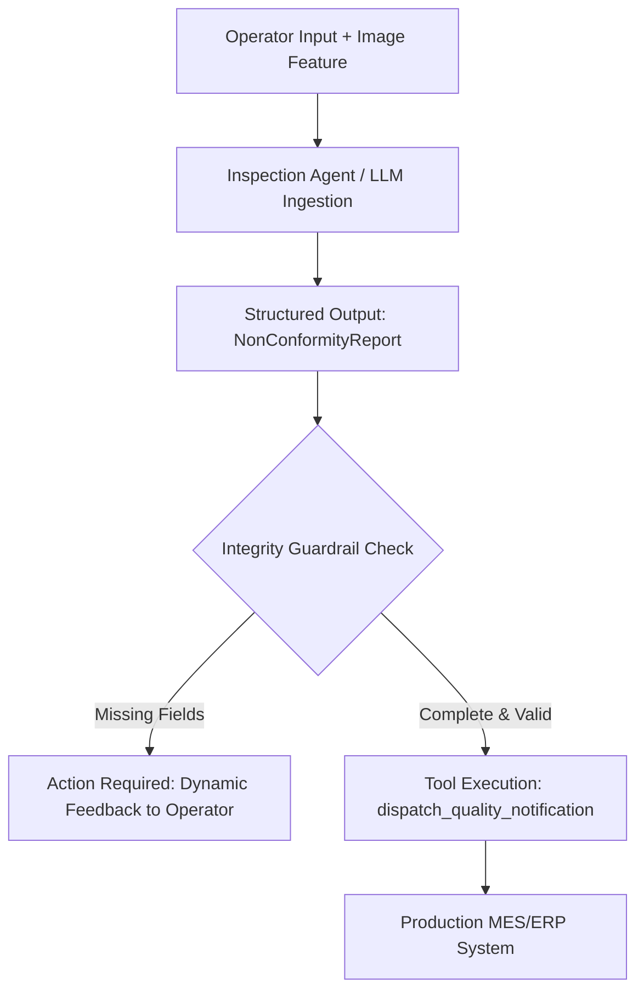

# 🛰️ Multimodal Agent Inspector: Automated Technical Non-Conformity Pipeline

[](https://www.python.org/downloads/)
[](https://docs.pydantic.dev/)
[](https://opensource.org/licenses/MIT)

An enterprise-grade reference architecture for **Multimodal AI Agents** and **Structured Extraction Pipelines** designed for industrial inspection and quality assurance.

---

## 🎯 Architecture & Overview

In complex manufacturing environments, standardizing field reports (Non-Conformity Notes) is challenging due to noisy inputs, incomplete descriptions, and lack of technical consistency.

This project implements an **Agentic Decision Loop** combining:
1. **Multimodal Ingestion:** Handles textual operator logs and visual inspection features.
2. **Structured Outputs & Schema Contracts:** Enforces deterministic data contracts using **Pydantic v2** (JSON Schema).
3. **Guardrails & Interactive Feedback:** Automatically computes missing mandatory fields and prompts the operator dynamically instead of hallucinating values.
4. **Tool / Function Calling:** Triggers external enterprise APIs (MES/ERP) only when data completeness guarantees are met.
5. **Bilingual Harmonization:** Generates audited, standardized technical summaries in `pt-BR` and `en-US`.



---

## 🛠️ Tech Stack

* **Core Language:** Python 3.10+
* **Data Contracts & Validation:** Pydantic v2 (Strict Schema Enforcement)
* **Agent Architecture:** Modular Tool Calling, Deterministic Decision Trees, Zero-Shot & Few-Shot Prompts
* **Quality & Testing:** Pytest, Static Typing (`mypy`/`dataclasses`)

---

## 🚀 Quickstart

### 1. Clone & Setup
```bash
git clone https://github.com/vitoriasaldanha22/multimodal-agent-inspector.git
cd multimodal-agent-inspector
python -m venv venv
source venv/bin/activate  # On Windows: venv\Scripts\activate
pip install -r requirements.txt
```

### 2. Run the Inspection Pipeline
```bash
python -m src.pipeline
```

### 3. Run Automated Tests
```bash
pytest tests/ -v
```

---

## 💼 Industry Impact & Engineering Trade-offs

* **Guaranteed Determinism:** Eliminates unpredictable free-text LLM generations in mission-critical environments by forcing JSON Schema compliance.
* **Reduced Cycle Time:** Prevents back-and-forth communication in quality loops through immediate real-time missing field detection.
* **Enterprise Safety:** Zero exposure of proprietary schemas or internal endpoint credentials; architecture decoupled from specific model providers.
